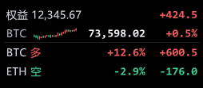

# 持仓盈亏悬浮窗

Windows 桌面上的极简持仓盈亏浮窗：全透明、置顶、不挡操作，扫一眼就知道账户权益和每笔仓位的浮盈。

> 目前接入 OKX，后续会支持其他交易所；界面、看盘、K 线窗这些是通用的。

## 下载

**[⬇ OkxPnl.exe](https://github.com/qianyexiaomu/crypto-pnl-overlay/releases/latest)** —— 约 80 KB，免安装，Win10/11 自带 .NET 即可运行。

## 三步开始

1. 双击 `OkxPnl.exe`
2. 右键悬浮条 →「填写 / 修改 API Key」（OKX 后台创建，权限**只勾「读取」**）
3. 状态灯变绿就通了

## 功能

- 三种外观：全透明 / 半透明底板 / 浅色卡片；位置可拖动并记住
- 极简单行与明细列表双击切换：方向、涨跌幅、未实现盈亏
- 面板内看盘：最多 6 个币对，实时价 + 24h 涨跌幅 + 小 K 线
- K 线窗：多币种同屏，MA5/10/20、布林带、撑压线、开仓/强平价、价格提醒
- 一键平仓（二次确认，需 Key 勾「交易」权限）
- 颜色反转（涨绿跌红）、数字描边、闲置变淡、单实例

## 快捷键

| 快捷键 | 作用 |
|---|---|
| `Ctrl + Alt + Z` | 悬浮窗 显示 / 隐藏 |
| `Ctrl + Alt + Q` | K 线窗 显示 / 隐藏 |

## 注意

- 直连 `www.okx.com`，网络不通请挂代理，或在 `pnl-config.ini` 写 `proxy=http://127.0.0.1:7890`
- Key 用 Windows DPAPI 加密存本机，换机器需重填
- 完整说明书见 [使用说明.txt](使用说明.txt)

## License

[CC BY-NC-SA 4.0](LICENSE) —— 可自用、可修改、可再分发，**不可商业使用**。

- 必须保留署名与协议声明
- 修改后的作品须以相同协议发布
- 商业使用请先联系作者授权
